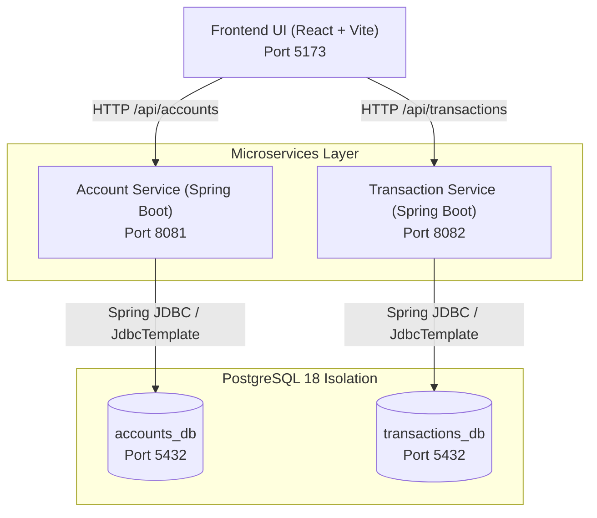

# SecureBank — Architecture Specification

## 1. System Overview

SecureBank is designed as a minimal, realistic banking application serving as the target platform for a multi-agent security verification system under the **Proactive Shift-Left Defense** hackathon track.

---

## 2. Key Architectural Decisions

### 2.1 Microservice Autonomy & Database Isolation
- **No Shared Databases**: Account Service exclusively owns `accounts_db`. Transaction Service exclusively owns `transactions_db`.
- **Zero Cross-Database Foreign Keys**: Transactions store `accountId` as a plain identifier (`VARCHAR(40)`). Consistency is maintained through application logic rather than database constraints.
- **Independent Deployability**: Either service can be restarted, upgraded, or redeployed without impacting the lifecycle of the other.

### 2.2 Direct SQL Access with `JdbcTemplate`
- Rather than using Spring Data JPA or Hibernate ORM (which abstracts SQL queries behind object graphs and criteria builders), the application uses **Spring JDBC** and **`JdbcTemplate`**.
- This makes SQL statements explicit, straightforward to inspect for AST analysis, and directly targets code-level vulnerability detection and patch synthesis.

### 2.3 Layered DTO Architecture
Each service strictly enforces:
- `Controller`: Thin HTTP endpoint definitions, input parameter extraction, and Jakarta Bean Validation (`@Valid`).
- `Service`: Business rules (e.g. server-side balance assignment, status transitions, reference generation).
- `Repository`: Direct SQL query execution, mapping via `RowMapper` implementations.
- `DTOs`: Distinct Request and Response contracts avoiding raw `Map` payloads or entity exposure.
- `GlobalExceptionHandler`: Centralized HTTP error mapping returning consistent JSON payloads.

---

## 3. Database Schemas

### 3.1 `accounts_db` — Table: `accounts`
| Column | Type | Constraints | Description |
|---|---|---|---|
| `account_id` | VARCHAR(40) | PRIMARY KEY | Unique account identifier |
| `user_id` | VARCHAR(40) | NOT NULL | Owning user identifier |
| `customer_name` | VARCHAR(120) | NOT NULL | Customer name |
| `account_number` | VARCHAR(30) | UNIQUE, NOT NULL | Public bank account number (`SB...`) |
| `account_type` | VARCHAR(20) | NOT NULL, CHECK in ('SAVINGS', 'CURRENT') | Product type |
| `currency` | VARCHAR(3) | NOT NULL | Currency code (INR) |
| `balance` | NUMERIC(19,2) | NOT NULL, DEFAULT 0, CHECK >= 0 | Account ledger balance |
| `status` | VARCHAR(20) | NOT NULL, CHECK in ('ACTIVE', 'FROZEN', 'CLOSED') | Operational status |
| `created_at` | TIMESTAMPTZ | NOT NULL | Creation timestamp |
| `updated_at` | TIMESTAMPTZ | NOT NULL | Last update timestamp |

**Indexes**:
- `idx_accounts_user_id` on `accounts(user_id)`
- `idx_accounts_customer_name` on `accounts(customer_name)`

### 3.2 `transactions_db` — Table: `transactions`
| Column | Type | Constraints | Description |
|---|---|---|---|
| `transaction_id` | VARCHAR(40) | PRIMARY KEY | Unique transaction identifier |
| `account_id` | VARCHAR(40) | NOT NULL | Reference to target account |
| `transaction_type` | VARCHAR(20) | NOT NULL, CHECK in ('DEBIT', 'CREDIT') | Transaction direction |
| `amount` | NUMERIC(19,2) | NOT NULL, CHECK > 0 | Transaction monetary value |
| `currency` | VARCHAR(3) | NOT NULL | Currency code (INR) |
| `description` | VARCHAR(255) | NOT NULL | Human-readable memo |
| `reference` | VARCHAR(80) | UNIQUE, NOT NULL | Business audit reference (`REF-...`) |
| `created_at` | TIMESTAMPTZ | NOT NULL | Timestamp |

**Indexes**:
- `idx_transactions_account_id` on `transactions(account_id)`
- `idx_transactions_created_at` on `transactions(created_at)`
- `idx_transactions_transaction_type` on `transactions(transaction_type)`

---

## 4. Port Allocation & Networking
| Component | Runtime | Port | Network Interface |
|---|---|---|---|
| Account Service | Java 21 / Spring Boot | 8081 | `http://localhost:8081` |
| Transaction Service | Java 21 / Spring Boot | 8082 | `http://localhost:8082` |
| Frontend UI | Node / Vite / React | 5173 | `http://localhost:5173` |
| PostgreSQL | PostgreSQL 18 | 5432 | `localhost:5432` |
